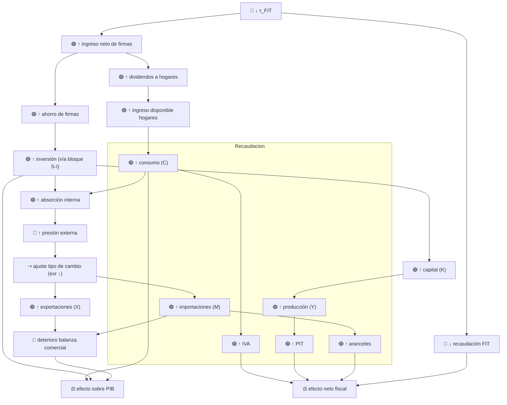
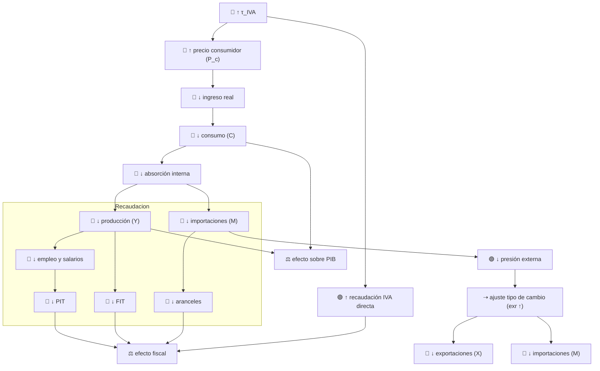
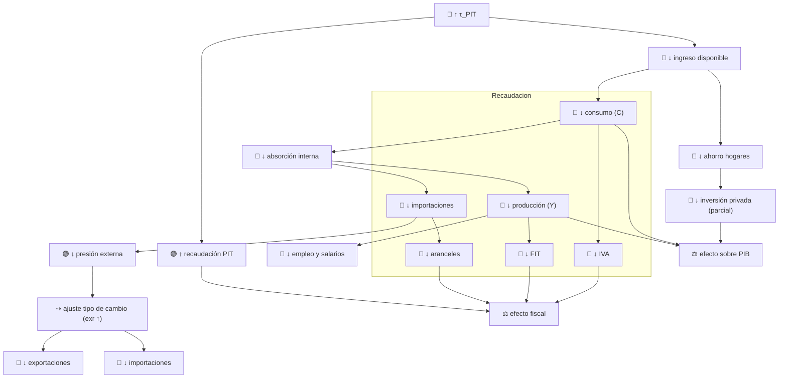
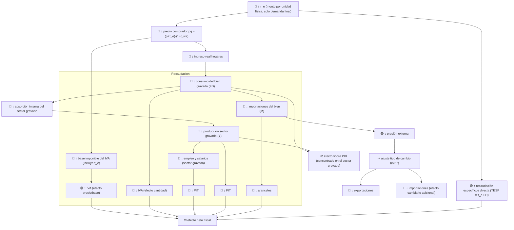

1. Disminución del Impuesto a las Empresas (FIT)

Shock: ↓ τ_FIT

Esquema de Transmisión

2. Aumento del IVA

Shock: ↑ τ_IVA

Esquema de Transmisión

3. Aumento del PIT

Shock: ↑ τ_PIT

Esquema de Transmisión

4. Aumento del Impuesto Específico (τ_e)

Shock: ↑ τ_e

Esquema de Transmisión

**Nota metodológica — diferencias frente al esquema del IVA:**

- El impuesto específico se modela como un monto fijo por unidad física (τ_e) aplicado únicamente a la demanda final (hogares, gobierno, inversión); el consumo intermedio queda exento por supuesto de diseño (`pint` no incorpora τ_e), replicando el criterio de la Ley N.º 18.502 sobre impuestos a los combustibles, expresados en UTM por metro cúbico —es decir, un impuesto específico (unitario), no ad valorem [@ley18502]. Al no gravar insumos intermedios, se cierra por construcción el canal de costo hacia otros sectores: el efecto real del shock queda concentrado en la demanda final y la producción del sector gravado; en la SAM 2023 calibrada, el 100% de la recaudación por Imptos_Espec recae sobre `prod_Manu`.
- El IVA se calcula sobre el precio que ya incorpora el específico, `pq=(p+τ_e)·(1+t_iva)`, en línea con el artículo 15 del D.L. N.º 825, que establece que la base imponible del IVA incluye los demás impuestos que afectan la operación, salvo el propio IVA [@dl825]. Esto genera un efecto de "impuesto sobre impuesto" (cascada): un alza de τ_e arrastra pasivamente mayor recaudación de IVA sobre la misma base, incluso sin cambios en la tasa `t_iva` [@keen_2013; @ebrill_etal_2001].
- A diferencia de un impuesto ad valorem —cuya recaudación depende tanto del precio como de la cantidad transada—, la recaudación del específico, `TESP = τ_e·FD`, depende solo del volumen físico de la demanda final gravada. Su elasticidad-base frente al shock está determinada exclusivamente por la elasticidad-precio de la demanda (erosión de cantidad), sin el canal adicional de dilución vía precio que sí opera en el IVA. Esta distinción entre tributación específica y ad valorem, y sus implicancias de incidencia y recaudación, es un resultado clásico de la literatura de imposición indirecta [@keen_1998; @delipalla_keen_1992; @cnossen_2005].
- El efecto neto sobre la recaudación de IVA es ambiguo por construcción: el canal de precio/base (`T_IVA_p`) opera en sentido contrario al canal de cantidad (`T_IVA_q`), tal como ocurre en el esquema del IVA (sección 2) — el signo neto depende de la elasticidad-precio de la demanda del bien gravado y debe resolverse numéricamente, no analíticamente.
